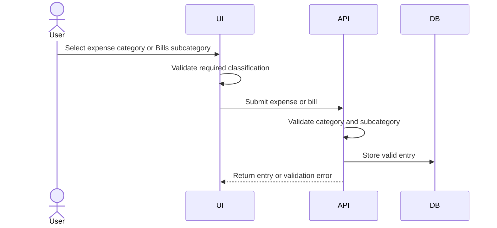

# Expense and bill categorization

## Status

Requirements confirmed; [issue #16](https://github.com/miguellemos95/household_finances/issues/16)
registered. Issue #15 is merged and closed. The flag-based redesign was merged
in [PR #18](https://github.com/miguellemos95/household_finances/pull/18), and
issue #16 was closed. Post-merge verification is recorded below.

## Confirmed classification redesign

- Add a boolean `is_bill_category` to categories instead of identifying the bill
  category by its display name. Only one category can be a bill category at a
  time; the existing Bills category should be marked during migration.
- Derive bill choices from the stored subcategories of the bill category rather
  than hardcoding their names. The current seed contains Water, Electricity,
  Heating, Home Internet, and Phone Plan; adding a subcategory later makes it a
  bill choice.
- A bill's one-off/monthly recurrence is a separate concept and is not the
  category classification.
- The expense dropdown, manual expense validation, bill validation, and expense
  list filtering should use the category flag. Existing expenses must remain
  stored and continue to contribute to totals and budgets as previously agreed.

Migration `0005_bill_category` adds the flag with a false default and marks the
existing seeded `Bills` category once. It reports an error if that legacy
category is missing; offline SQL includes the same precondition. A partial
unique index permits at most one flagged category. Existing financial records
are not rewritten. If no flagged category or no stored subcategories are
available, the bill form reports an error.

## Requested behavior

- The bill form should present the bill category's stored subcategories as a
  mandatory choice. The current seed contains Water, Electricity, Heating, Home
  Internet, and Phone Plan.
- The expense form should not offer Bills, but should offer the other categories.
- For other expense categories, require a subcategory when the category has
  subcategories, and do not require one when it has none.
- Hide all Bills-category expenses from the expense list, including any
  previously recorded manual expenses in that category.
- Exclude Bills-category entries from the `GET /expenses` API response.
- Keep paid bills in household totals and the Bills budget.
- Enforce the creation rules in both the API and forms.
- The user reports that there are no existing bills in the system.

This changes the existing optional-subcategory rule documented in
[Personal Expense Tracking](personal-expense-tracking.md).

## Design

- The bill form presents a single required choice from the flagged category's
  stored subcategories and sends the category and selected subcategory.
- The expense form excludes the flagged category from manual expense entry.
  `GET /expenses` excludes its records, while monthly totals and budgets include them.
- Validate the classification rules at the API boundary and in the forms.
- Paid bills continue to create internal expense records for the paid month;
  those records remain included in the monthly summary and Bills budget.
- Existing records are not rewritten; the schema remains nullable for historical
  records. Missing bill classification data produces an error in the form.

## Acceptance criteria

1. The bill form offers the flagged category's stored subcategories and requires
   one. The API rejects a bill without a valid subcategory or with a non-bill
   category.
2. The expense form excludes the bill category and requires a subcategory for any other
   category that has subcategories. The API enforces the same rule and rejects
   subcategories that do not belong to the chosen category.
3. Categories without subcategories can be used without one.
4. `GET /expenses` and the expense list exclude all Bills-category records,
   including existing manual records, without deleting them.
5. Paid bills remain included in household expense totals, balance, and the
   Bills category budget for the paid month.
6. Invalid submissions report an error and do not create a record.

## Flow

## Sequencing

Issue #15 was merged before issue #16 was implemented separately.

## Ticket draft

**Title:** Require appropriate categories for expenses and bills

**Description:** Restrict bill creation to a required Bills subcategory, exclude
Bills from manual expense creation, and require subcategories for other expense
categories that have them. Enforce these rules in both UI and API. Hide all
Bills-category expenses from the list while retaining paid bills in household
totals and the Bills budget. Exclude Bills-category entries from `GET /expenses`.
Implement after issue #15 is merged. Include focused frontend and backend tests
and a consolidated test and error-handling table.

**Registered ticket ID:** [#16](https://github.com/miguellemos95/household_finances/issues/16).

## Test and error-handling evidence for the initial implementation

Executed locally on 2026-11-21 for the superseded name-based implementation;
these results do not verify the classification redesign. Backend tests used temporary SQLite databases;
`TEST_DATABASE_URL` was cleared for the test process. PostgreSQL-specific tests
were not run, and no live API/database or browser integration check was performed.
Application error handling is in scope; infrastructure failover is not.

| ID | Acceptance criterion | Level / scenario | Expected | Actual | Status | Evidence |
| --- | --- | --- | --- | --- | --- | --- |
| CAT-001 | 1 | API: create a bill with each approved subcategory | All five accepted | All five returned `201` | Passed | `test_bill_accepts_each_approved_subcategory` |
| CAT-002 | 1, 6 | API errors: missing, unrelated or unapproved subcategory; non-Bills or unknown category | `422` identifying the field; no bill created | As expected | Passed | `test_bill_requires_subcategory_field`, `test_bill_requires_bills_subcategory`, `test_bill_rejects_subcategory_from_another_category`, `test_bill_rejects_unapproved_bills_subcategory`, `test_invalid_bill_is_rejected` |
| CAT-003 | 1, 6 | Component: bill selection, missing selection, missing category data, successful and failed save | Only five choices; invalid input is not sent; missing data and API failure are visible; valid request sends Bills and selection | As expected with mocked API | Passed | `ledger-page.spec.ts` |
| CAT-004 | 2, 3, 6 | API: required subcategories across Beauty, Transports and Eat out; Groceries and Clothes without one; manual Bills, mismatched and unknown subcategories | Valid classifications accepted; invalid requests return `422`, with no new expense | As expected | Passed | `test_expense_requires_subcategory_when_category_has_one`, `test_expense_without_subcategories_does_not_require_one`, `test_manual_expense_cannot_use_bills`, `test_expense_rejects_subcategory_of_another_category`, `test_invalid_expense_is_rejected_and_not_stored` |
| CAT-005 | 2, 3, 6 | Component: manual category selection, mandatory subcategory, switch to a category without one, failed save | Bills absent; missing subcategory is rejected; switching clears it; API failures remain visible | As expected with mocked API | Passed | `ledger-page.spec.ts` |
| CAT-006 | 4, 5 | API: historical Bills expense plus ordinary expense | Only ordinary expense listed; historical record remains stored and included in balance and Bills budget | As expected | Passed | `test_historical_bills_expense_is_hidden_but_included_in_totals` |
| CAT-007 | 4, 5 | API: pay a bill in a later month | Paid expense hidden from list; paid month's total, balance and Bills budget include payment; prior month unchanged | As expected | Passed | `test_bill_payment_counts_in_paid_month_and_budget` |
| CAT-008 | 6 | API: failed expense or bill-payment commit | Sanitized `503`; no expense stored; bill remains unpaid | Existing regression tests passed | Passed | `test_failed_expense_write_is_reported_and_not_stored`, `test_failed_bill_payment_rolls_back_expense` |
| CAT-009 | Regression / concurrency | Concurrent PostgreSQL payments and bill listing | One payment/expense and one generated occurrence | Skipped: SQLite selected; no dedicated PostgreSQL test database configured for this run | Not run | `test_concurrent_bill_payments_create_one_expense`, `test_concurrent_bill_listing_generates_one_occurrence` |

Commands: backend `python -m pytest -q`: 100 passed, 2 skipped; frontend
`npm test -- --watch=false`: 58 passed; `npm run build`: passed. Pylance syntax
checks found no Python syntax errors.

## Test and error-handling evidence for the redesign

The automated checks ran locally on 2026-11-21 with temporary SQLite databases
and mocked frontend API responses. The user subsequently authorized applying
the migration to the local PostgreSQL development database.

| ID | Requirement / scenario | Expected | Actual | Status | Evidence |
| --- | --- | --- | --- | --- | --- |
| FLAG-001 | Rename the flagged category and give an ordinary category the old name | Expense entry, bill creation and filtered reads follow the flag, not the display name; totals include historical records | As expected | Passed | `test_bill_classification_does_not_depend_on_category_name`; `ledger-page.spec.ts` |
| FLAG-002 | Add another stored bill subcategory | The UI offers it and the API accepts it | As expected | Passed | `test_bill_accepts_new_stored_subcategory`; `ledger-page.spec.ts` |
| FLAG-003 | Upgrade from `0004_bills` with an existing expense, then downgrade | One seeded category marked; expense survives unchanged in both directions | As expected on SQLite | Passed | `test_bill_category_migration_preserves_data_and_enforces_uniqueness` |
| FLAG-004 | Mark a second category as a bill category | Database rejects it | SQLite unique-index violation as expected | Passed | `test_bill_category_migration_preserves_data_and_enforces_uniqueness` |
| FLAG-005 | Legacy Bills seed missing during migration | Migration reports failure before changing the categories schema | Online and offline SQLite checks failed explicitly as expected | Passed | `test_bill_category_migration_reports_missing_seed_before_altering_schema`; `test_offline_bill_category_migration_checks_for_missing_seed` |
| FLAG-006 | Missing bill category, invalid classification or missing subcategory | UI displays an error; API rejects invalid requests without saving | As expected | Passed | `ledger-page.spec.ts`; `test_bill_requires_subcategory_field`; `test_bill_requires_bills_subcategory`; `test_bill_rejects_subcategory_from_another_category` |
| FLAG-007 | Paid and historical bill expenses | Excluded from expense list, preserved in paid-month totals, balance and budget | As expected | Passed | `test_historical_bills_expense_is_hidden_but_included_in_totals`; `test_bill_payment_counts_in_paid_month_and_budget` |
| FLAG-008 | PostgreSQL concurrency | Concurrent payments and bill listing remain safe | Two PostgreSQL-only concurrency tests not run | Not run | Backend test skips |
| FLAG-009 | Apply migration to the approved local PostgreSQL database | Upgrade from `0004_bills` and mark only the existing Bills category | Revision `0005_bill_category`; Bills true and the other five categories false | Passed | `alembic upgrade head` and read-only category query on `household_finances` at localhost |

Regression commands: backend `python -m pytest -q`: 105 passed, 2 PostgreSQL-only
tests skipped; frontend `npm test -- --watch=false`: 59 passed; `npm run build`:
passed. Pylance reported no errors in the changed backend files. No live browser
check was performed. Infrastructure failover is out of scope.

### Post-merge verification

On 2026-11-24, the merged `master` tree matched the tested implementation.
Backend tests passed (105 passed, 2 PostgreSQL-only concurrency tests skipped);
frontend tests passed (59 passed), as did the production build. The running
frontend returned HTTP 200, the API reported ready, and its category response
contained one flagged bill category. The skipped concurrency tests and a live
browser interaction were not verified in this run.
