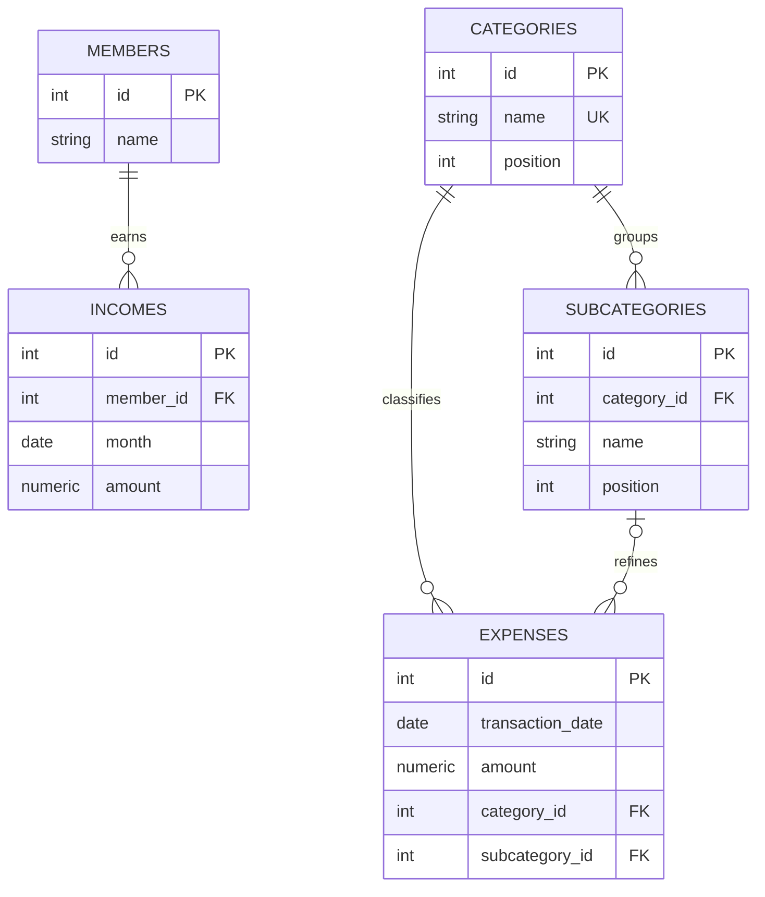
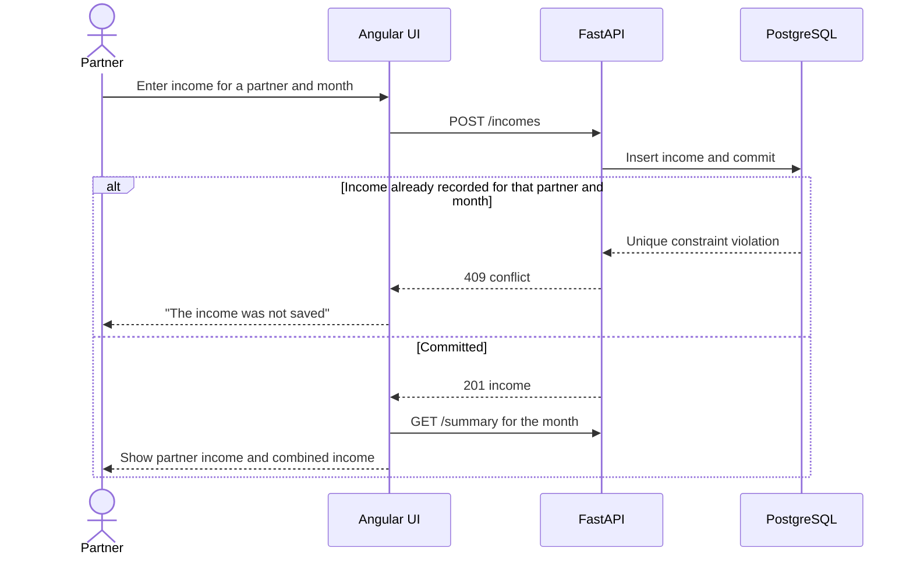

# Personal Expense Tracking

## Status

Requirements are partially confirmed and the initial architecture is selected. GitHub issues #1-#4 are registered. Issue #1 is completed and closed: Angular and FastAPI local checks and PostgreSQL container integration pass. Issue #2 (expense and income ledger with monthly summary) is implemented and verified on the `issue-2-expense-income-ledger` branch; it stays open until its pull request is reviewed and merged. Remaining product decisions must be resolved before implementing affected later issues.

## Objective

Manage shared household finances for two partners, recording household expenses and the income of each partner.

## Workbook Observations

Source: `Pingvinukas_Coins.xlsx` in the parent workspace directory (outside this repository).

- The workbook has a `General` sheet and separate `Bills`, `Groceries`, `Beauty`, `Transports`, `Eat_out`, and `Clothes` sheets.
- The sheets contain month rows for November and December. The `General` sheet also contains numeric values in columns C and D, but those columns have no visible headers.
- The `General` sheet has visible `Total`, `Profit`, and `Expenses` headings. Formulas add the unlabeled C/D values for `Total`, subtract `Expenses` from `Total` for `Profit`, and aggregate category totals for `Expenses`.
- The user confirmed that column D (blue) is their income and column C (pink) is their girlfriend's income. Household expenses are counted together, not attributed to either partner.
- Expense sheets contain category-specific subcategory headings and monthly totals. For example, `Bills` includes Water, Electricity, Heating, Home Internet, and Phone Plan; `Transports` includes Bus, Spark, and Bolt/Uber.
- The user wants expenses recorded on their actual dates. The application currency is euros (EUR).
- Preserve the workbook's expense categories and subcategories, except omit the Groceries subcategories for now. The Groceries category itself remains.
- Budgets, recurring bills, and income tracking are in scope. Their detailed behavior remains to be agreed.
- The workbook does not visibly record individual transaction dates, merchants, or descriptions. These are workbook observations only; no requirement to include or exclude merchant/description fields has been confirmed.
- The `Groceries` sheet spells one subcategory `Diary`; Grocery subcategories are out of scope for now, so this label does not need to be resolved for the initial version.

## Confirmed Requirements

| ID | Type | Requirement |
| --- | --- | --- |
| FEAT-001 | Functional | Record household expenses by actual date, in EUR. An expense cannot be dated after the current day. |
| FEAT-002 | Functional | Count expenses together as household expenses; do not attribute an expense to one partner. |
| FEAT-003 | Functional | Track income separately for the user and girlfriend, and support a combined household income view. The spreadsheet mapping is D (blue) = user and C (pink) = girlfriend. Income is one amount per partner per month; a second amount for the same partner and month is rejected. |
| FEAT-004 | Functional | Use the expense categories and non-Groceries subcategories found in the workbook. Omit Groceries subcategories for the initial scope. A subcategory is optional even where the category has subcategories. The workbook's `Eat_out` category is shown as "Eat out"; other labels are kept as in the workbook. |
| FEAT-005 | Functional | Support monthly budgets per expense category and show a free in-app warning when actual spending reaches 80% of a category limit. Show an exceeded state above 100%. |
| FEAT-006 | Functional | Allow one-off bills and monthly recurring bills to be registered with pending or paid status and a due date. Recurring bills provide a default amount that can be adjusted for each occurrence before payment. Show pending/overdue bills in the app without paid email, SMS, or push services. A bill contributes to actual expenses and budgets only when marked paid, using its paid amount and paid date. |
| FEAT-007 | Functional | Provide monthly household summaries with combined income, combined expenses, and the remaining balance (income minus expenses). |
| FEAT-008 | Functional | Each partner has a label shown in the app. The defaults are "Azul" for the user and "Pinketa" for the girlfriend, and either label can be changed through the UI. |
| TECH-001 | Technology constraint | Use Angular for the frontend. |
| TECH-002 | Technology constraint | Use Python for the backend. |
| TECH-003 | Architecture decision | Use FastAPI for a typed REST API with generated OpenAPI documentation and request validation. |
| TECH-004 | Architecture decision | Use PostgreSQL for persistent relational data, with SQLAlchemy for persistence and Alembic for schema migrations. Use Python `Decimal` and PostgreSQL `NUMERIC` for EUR amounts to avoid binary floating-point rounding. |
| NFR-001 | Maintainability | Follow SOLID, DRY, and KISS; keep code simple, scalable, and testable, avoiding hacks and drift. |
| NFR-002 | Testing | Include tests for each implementation and maintain a consolidated test/error-handling table with actual execution results. |
| NFR-003 | Security and privacy | No elevated security or privacy requirements have been requested. Access/deployment model remains open; this does not remove ordinary input validation or safe error handling. |
| NFR-005 | Cost | The app should be free to use and should not require paid licenses or notification services. Hosting costs depend on the deployment choice, which remains open. |

## Scope and Boundaries

- Confirmed: dated household expenses that cannot be in the future; one income amount per partner per month; partner labels that can be changed in the UI; combined household expense totals; categories and subcategories copied from the workbook except Groceries subcategories, with the subcategory optional; EUR; monthly summaries; a single ledger page; monthly budgets per category with an in-app warning at 80%; and one-off or monthly recurring bills with pending/paid state, in-app pending/overdue visibility, and expense accounting only on the paid date.
- Not confirmed: whether expenses and income can be edited/deleted; required transaction metadata beyond date, amount, and category; income dates and sources beyond one monthly amount per partner; and account/access and deployment model.
- Treat spreadsheet sample values and formulas as reference data, not as requirements. In particular, do not carry over spreadsheet formula behavior without confirming the desired calculations.

## Acceptance Criteria

- A user can record an expense with an actual date that is not in the future, EUR amount, and applicable workbook category and optional subcategory; it contributes to shared household expense totals rather than an individual partner's total, in the month of its transaction date.
- A user can record one income amount per month for either partner and view the two partner-specific amounts separately and together. A second amount for the same partner and month is rejected with a clear message.
- A user can change either partner's label; the defaults are "Azul" and "Pinketa".
- Expense categories match the workbook, with `Eat_out` shown as "Eat out"; Groceries has no subcategory selection in the initial version.
- Monthly summaries show combined income, combined expenses, and income minus expenses.
- Monthly budgets are tracked per expense category; an in-app warning appears at 80% and an exceeded state appears above 100%, with no external paid notification service.
- One-off and monthly recurring bills have due dates and pending/paid status. Recurring bills use a default amount that can be adjusted per occurrence. Pending and overdue bills are visible in-app; marking a bill paid records its paid amount and paid date, and only then does it contribute to actual expense totals and budgets.
- Invalid input and backend/storage failures produce controlled, understandable errors and do not report an unsuccessful write as successful.
- Detailed acceptance criteria for alert thresholds, recurring-bill scheduling, and account access are pending the open decisions below.

## Design and Architecture

Selected initial architecture:

```text
Angular application -> FastAPI REST API -> PostgreSQL
							|
				  SQLAlchemy + Alembic
```

- FastAPI keeps the Python backend focused on a typed HTTP API, validation, and OpenAPI contracts. It is a good fit for a small, testable application without introducing a larger framework's extra conventions.
- PostgreSQL provides relational integrity and transactional writes for expenses, income, budgets, recurring bills, and categories. It is a suitable default for a shared household application where both partners may use it.
- SQLAlchemy is the persistence boundary; Alembic manages schema changes. Keep domain calculations and validation out of route handlers so they can be tested independently.
- Represent money with decimal arithmetic (`Decimal` in Python; `NUMERIC` in PostgreSQL), not floating point. Currency is fixed to EUR for the current scope.
- Keep the backend as one modular application; no microservices are warranted by the current scope.
- Authentication, hosting, and deployment topology are not selected because the access model and operating environment are not yet known.

### Issue #2 ledger design

Decisions confirmed with the user on 2026-11-21 before implementation:

| Decision | Choice |
| --- | --- |
| Income model | One amount per partner per month; a second amount for the same partner and month is rejected. |
| Partner labels | Default "Azul" (user, workbook column D) and "Pinketa" (girlfriend, workbook column C); changeable through the UI. |
| Subcategory | Optional where the category has subcategories. |
| Category labels | `Eat_out` is shown as "Eat out"; other workbook labels are unchanged. |
| Future-dated expenses | Rejected. "Today" is the API server's local date. |
| Screen layout | One page: month selector, summary, income per partner, add-expense form, and that month's expenses. |

Backend structure (`backend/app`):

- `models.py` holds the SQLAlchemy models; `alembic/versions/0002_ledger.py` creates the tables and seeds the two members and the workbook categories and subcategories. Alembic uses the model metadata, so `alembic check` detects drift between models and migrations.
- `schemas.py` and `months.py` define the request/response contract. Amounts are `Decimal` values greater than 0 with at most 12 digits and 2 decimals, stored as `NUMERIC(12,2)` and exchanged as JSON strings. Months are exchanged as `YYYY-MM` and stored as the first day of the month.
- `ledger_service.py` holds the domain rules and calculations; `ledger_router.py` only maps HTTP to the service.
- `errors.py` gives every failure one shape, `{"detail": {"code", "message", "errors"?}}`: `422 invalid_input`, `404 not_found`, `409 conflict`, and a sanitized `503 database_unavailable`. Storage error details are logged on the server and never returned.
- `database.commit` rolls back when a commit fails. Without it, SQLAlchemy returns the connection to the pool with the failed transaction still open, which would expose the unsaved work to later requests.

API:

| Endpoint | Behavior |
| --- | --- |
| `GET /categories` | Categories in workbook order, each with its subcategories. |
| `GET /members` | The two partners with their labels. |
| `PATCH /members/{id}` | Change a partner's label (trimmed, 1-50 characters). |
| `POST /expenses` | Record an expense; validates date, amount, category, and that a subcategory belongs to the category. |
| `GET /expenses?month=YYYY-MM` | Expenses whose transaction date is in the month, newest first. |
| `POST /incomes` | Record a partner's income for a month; `409` if one already exists. |
| `GET /incomes?month=YYYY-MM` | Incomes recorded for the month. |
| `GET /summary?month=YYYY-MM` | Each partner's income (or none), combined income, combined expenses, and balance. |

Frontend structure (`frontend/src/app`): the `App` shell keeps the API status and hosts the routed `LedgerPage`, which loads the month and composes `PartnerIncome` (label and monthly income per partner) and `ExpenseForm`. Amounts are kept as text between the form and the API so no floating-point arithmetic touches a money value. After an expense is recorded the page shows the month of that expense, so the updated total is visible.

Not part of issue #2: editing or deleting records, description/payee, income dates and sources, per-category totals in the summary, budgets, and bills.

## Glossary

| Term | Meaning |
| --- | --- |
| Household | The shared financial scope of the two partners. |
| Member / partner | One of the two people in the household. Income belongs to a member; expenses do not. |
| Label | The name shown for a member; "Azul" and "Pinketa" by default. |
| Expense | A dated EUR amount in a category, optionally with a subcategory, shared by the household. |
| Transaction date | The actual date of an expense; it decides which month the expense counts towards. |
| Income | One EUR amount for one member for one month. |
| Month | A calendar month, written `YYYY-MM`. |
| Combined income | The sum of both members' incomes for a month. |
| Remaining balance | Combined income minus combined expenses for a month; it can be negative. |
| Category / subcategory | The expense classification taken from the workbook. |

## Domain Model and Diagrams

Domain concepts. Household, member, expense, income, and category behavior is implemented by issue #2; budget and bill behavior is pending issues #3 and #4:

- **Household:** the shared financial scope. It is implicit: the application serves one household, so there is no household record.
- **Member:** one of the two partners, with a changeable label; income is associated with a member.
- **Expense:** dated EUR amount and category, optionally a subcategory where that category has subcategories. It belongs to the household and is not assigned to a member.
- **Income:** EUR amount associated with one member for one month; at most one per member and month.
- **Category / subcategory:** the expense classification from the workbook, except Groceries subcategories are omitted initially.
- **Budget:** a monthly spending limit for an expense category; show an in-app warning at 80% and an exceeded state above 100%.
- **Bill:** a one-off or monthly recurring payable item with due date and pending or paid status. A recurring occurrence starts with the schedule's default amount, which can be adjusted; only its paid amount contributes to actual expenses, on its paid date.
- **Recurring bill:** a monthly schedule that produces pending bill occurrences; pending and overdue occurrences are shown in-app without external notifications.

Data model implemented by issue #2:



Recording an expense:

```mermaid
sequenceDiagram
	actor Partner
	participant UI as Angular UI
	participant API as FastAPI
	participant DB as PostgreSQL
	Partner->>UI: Enter date, EUR amount, category, optional subcategory
	UI->>UI: Validate date and amount
	UI->>API: POST /expenses
	API->>API: Validate date, amount, category, subcategory
	alt Invalid entry
		API-->>UI: 422 invalid_input
		UI-->>Partner: Show what to correct; nothing saved
	else Valid entry
		API->>DB: Insert expense and commit
		alt Commit fails
			API->>DB: Roll back
			API-->>UI: 503 database_unavailable
			UI-->>Partner: "The expense was not saved"
		else Committed
			API-->>UI: 201 expense
			UI->>API: GET /summary, /expenses for the expense's month
			UI-->>Partner: Show confirmation and updated household totals
		end
	end
```

Recording a partner's monthly income:



## Open Questions

- Income is currently one amount per partner per month, without a date or source. Should income entries later have actual dates, and can either partner have multiple income sources?
- Can users edit/delete financial records? Is a description or payee needed on expenses? Until this is decided, a mistaken expense or income cannot be corrected in the app.
- Are workbook categories fixed, or should users be able to add/edit categories later?
- Does each partner need an individual login, or is a single shared household access method sufficient? Where will the application run?
- What accessibility expectations apply? No elevated security/privacy requirements were requested.
- Must hosting also have zero cost, or does "free" mean no charge to use the app and no paid software/notification services? Hosting costs depend on the eventual deployment choice.

## Registered GitHub Tickets

| Issue | Scope | Status |
| --- | --- | --- |
| [#1 Scaffold Angular, FastAPI, and PostgreSQL foundation](https://github.com/miguellemos95/household_finances/issues/1) | Local app/API/database foundation, health/readiness, migrations, startup documentation, and test setup. | Completed and closed; PostgreSQL integration verified |
| [#2 Implement household expense and income ledger](https://github.com/miguellemos95/household_finances/issues/2) | Shared dated expenses, per-partner monthly income, changeable partner labels, workbook categories, and monthly summary. Depends on #1. | Implemented and verified on `issue-2-expense-income-ledger`; draft pull request [#6](https://github.com/miguellemos95/household_finances/pull/6) awaits review; the issue stays open until it is merged |
| [#3 Add monthly category budgets and in-app alerts](https://github.com/miguellemos95/household_finances/issues/3) | Monthly category budgets with in-app 80% warning and over-budget state. Depends on #2. | Registered |
| [#4 Add one-off and recurring bill tracking](https://github.com/miguellemos95/household_finances/issues/4) | One-off/monthly bills, due dates, pending/paid lifecycle, adjustable occurrences, and paid-date expense accounting. Depends on #2 and #3. | Registered |

The user's request to register these issues and begin implementation authorized #1; the user's request on 2026-11-21 to work on #2 authorized #2. Do not start #3-#4 until their dependencies and remaining product questions are addressed.

## Tests and Failover

The consolidated "failover" table primarily covers application error handling; infrastructure failover is out of scope. The following table records #1 (`FND`) and #2 (`LED`) outcomes. Do not report unexecuted checks as passed.

| Test ID | Requirement / acceptance criterion | Level | Scenario / failure condition | Expected outcome / recovery | Actual outcome | Status | Evidence |
| --- | --- | --- | --- | --- | --- | --- | --- |
| FND-001 | #1 local startup and frontend/API communication | Smoke | Start Angular and FastAPI; open the documented localhost URL | Both start and the frontend reports API connected | Passed: `/health/live` returned `200`; Angular displayed “API connected” at `http://localhost:4200/` | Passed | Local FastAPI and Angular dev servers |
| FND-002 | #1 readiness and error handling | API / error path | Check readiness with PostgreSQL unavailable; exercise healthy and failed SQLAlchemy connections in tests | Live endpoint remains available; readiness returns controlled `503`; no database internals leak | Passed: live returned `200`; readiness returned `503`; tests verified SQLite readiness and sanitized SQLAlchemy failure response | Passed | `backend/tests/test_health.py`; local HTTP checks |
| FND-003 | #1 migration setup | Integration | Initialize a clean temporary database with Alembic and generate PostgreSQL migration SQL | Migration completes and the revision is recorded | Passed against temporary SQLite; PostgreSQL-dialect SQL generation passed offline; baseline migration also applied to local PostgreSQL | Passed | `test_clean_database_can_be_initialized_by_migrations` (replaced in #2 by `tests/test_migrations.py`, see LED-016); `alembic upgrade head --sql`; local `alembic upgrade head` and `alembic current` |
| FND-004 | #1 test setup | Automated | Run documented frontend/backend test commands and frontend production build | All tests and build complete successfully | Backend: 4 passed; Angular: 2 passed; production build passed | Passed | `python -m pytest`; `npm test -- --watch=false`; `npm run build` |
| FND-005 | #1 PostgreSQL service integration | Infrastructure / integration | Start PostgreSQL with `docker compose` and run readiness and migrations against it | PostgreSQL starts, readiness succeeds, and migrations complete | Passed on 2026-11-21: container healthy, PostgreSQL migration at `0001_initial`, API readiness returned `200` against PostgreSQL; backend tests 4 passed | Passed | `docker compose up -d --wait db`; `pg_isready`; `alembic upgrade head`; API readiness check; `python -m pytest` |
| LED-001 | #2 seed data; FEAT-004 | API / integration | Read categories after migrating a clean database | Workbook categories in order; Groceries and Clothes without subcategories; "Eat out" label | As expected on SQLite and PostgreSQL | Passed | `test_categories_match_workbook_without_groceries_subcategories` |
| LED-002 | #2 partner labels; FEAT-008 | API | Read default labels; change a label with surrounding spaces | Defaults "Azul" and "Pinketa"; new label is trimmed, stored, and shown in the summary | As expected | Passed | `test_members_have_default_labels`; `test_member_label_can_be_changed` |
| LED-003 | #2 invalid entries; FEAT-008 | API / error path | Rename with an empty, blank, or 51-character label; rename an unknown member | `422 invalid_input` naming `name`, or `404 not_found`; labels unchanged | As expected | Passed | `test_member_label_rejects_invalid_names`; `test_unknown_member_cannot_be_renamed` |
| LED-004 | #2 record and view expenses; FEAT-001, FEAT-002, FEAT-004 | API | Record an expense with a subcategory, without one, and dated today | `201`; amount returned as a two-decimal string; listed in its month | As expected | Passed | `test_expense_is_recorded_with_category_and_subcategory`; `test_expense_subcategory_is_optional`; `test_expense_dated_today_is_accepted` |
| LED-005 | #2 "A recorded expense appears in the correct monthly household total based on its transaction date" | API | Expenses on 31 Oct, 1 Nov, 30 Nov, 1 Dec 2025 and 29 Feb 2024 | Each counts only towards its own month; the month list is newest first | As expected | Passed | `test_expenses_count_towards_the_month_of_their_transaction_date` |
| LED-006 | #2 invalid entries; FEAT-001 | API / error path | Amount zero, negative, three decimals, non-numeric, or too large; future or impossible date; unknown category or subcategory; subcategory of another category or on Groceries; missing fields | `422 invalid_input` naming the field; nothing stored | As expected | Passed | `test_invalid_expense_is_rejected_and_not_stored`; `test_expense_requires_date_amount_and_category`; `test_expense_rejects_subcategory_of_another_category` |
| LED-007 | #2 income per partner; FEAT-003 | API | Record a partner's income for a month | `201`; listed for that month only | As expected | Passed | `test_income_is_recorded_for_a_member_and_month` |
| LED-008 | #2 one income per partner per month; FEAT-003 | API / error path | Record a second income for the same partner and month | `409 conflict`; first amount kept; the other partner and another month are still accepted | As expected | Passed | `test_second_income_for_the_same_member_and_month_is_rejected` |
| LED-009 | #2 invalid entries; FEAT-003 | API / error path | Income with amount zero, negative, or three decimals; malformed month; unknown member | `422 invalid_input` naming the field; nothing stored | As expected | Passed | `test_invalid_income_is_rejected_and_not_stored` |
| LED-010 | #2 "partners' income amounts remain separately visible and contribute to the combined monthly income"; "remaining balance equals combined income minus combined expenses"; FEAT-007 | API | Workbook November amounts: incomes 4053.50 and 2025.00, nine expenses | Incomes listed per partner; combined income 6078.50; expenses 707.23; balance 5371.27 | As expected; matches the workbook's November row | Passed | `test_summary_keeps_partner_incomes_separate_and_combines_totals` |
| LED-011 | #2 summary edge cases; FEAT-007 | API | Month without records; expenses larger than income | Zero totals with no partner income; negative balance | As expected | Passed | `test_summary_of_a_month_without_records_is_zero`; `test_summary_balance_is_negative_when_expenses_exceed_income` |
| LED-012 | #2 "Money calculations use decimal-safe EUR values"; TECH-004 | API / integration | Expenses 0.10 and 0.20 with income 0.30 | Expenses exactly 0.30 and balance exactly 0.00 | As expected. PostgreSQL `NUMERIC` is the meaningful run; SQLite stores decimals as floating point, so its pass does not prove exactness | Passed | `test_summary_uses_exact_decimal_arithmetic` with `TEST_DATABASE_URL` |
| LED-013 | #2 invalid entries | API / error path | `/expenses`, `/incomes`, and `/summary` with month `2025-13`, text, or no month | `422 invalid_input` naming `month` | As expected | Passed | `test_month_query_must_be_a_valid_month` |
| LED-014 | #2 "persistence errors return controlled errors and do not appear as successful writes" | API / error path | The commit fails while recording an expense, recording an income, or renaming a member | Sanitized `503 database_unavailable`; nothing stored; a later write succeeds | First run failed: the unsaved change was visible to the next request because SQLAlchemy returned the pooled connection with the failed transaction still open. Fixed by rolling back in `database.commit`; passes since | Passed after fix | `test_failed_expense_write_is_reported_and_not_stored`; `test_failed_income_write_is_reported_and_not_stored`; `test_failed_member_rename_is_reported_and_not_stored` |
| LED-015 | #2 persistence errors; NFR-004 | API / error path | Database connection fails for each read endpoint; API running with PostgreSQL unreachable | Sanitized `503 database_unavailable`; no connection details in the response | As expected in tests. Against an unreachable PostgreSQL, `POST /expenses` and `GET /summary` returned the sanitized `503` and the traceback appeared only in the server log | Passed | `test_reads_report_an_unavailable_database_without_details`; `curl` against the API on 2026-11-21 |
| LED-016 | #2 migrations; NFR-003 | Integration | Migrate a clean database to head and back to empty; compare models with migrations; generate PostgreSQL SQL offline | Head revision `0002_ledger` with the ledger tables; downgrade succeeds; no drift; SQL is generated | As expected on SQLite and PostgreSQL; local development database upgraded to `0002_ledger` with `alembic check` reporting no differences | Passed | `tests/test_migrations.py`; fixture teardown downgrade; `alembic upgrade head --sql`; `alembic check` |
| LED-017 | #2 ledger page; FEAT-001, FEAT-003, FEAT-007, FEAT-008 | Component | Load the current month; move to another month; record an expense, including one dated in another month; record an income; rename a partner | Totals, partner incomes, and expenses are shown; prior-month figures are hidden until the selected month loads; requests carry amounts as text; the page refreshes after each write | As expected | Passed | `frontend/src/app/ledger/ledger-page.spec.ts` |
| LED-018 | #2 controlled errors in the UI; NFR-004 | Component / error path | API unreachable while loading; expense write returns `503`; income returns `409`; label returns `422`; invalid amount entered | Understandable message; no confirmation; stale figures hidden; retry available; invalid entries are not sent | As expected | Passed | `frontend/src/app/ledger/ledger-page.spec.ts` |
| LED-019 | #2 frontend helpers | Unit | Month arithmetic across years, local date formatting, and amount parsing | Correct months and dates; invalid amounts such as `0`, `1.234`, and `12,50` rejected | As expected | Passed | `month.spec.ts`; `amount.spec.ts` |
| LED-020 | #2 regression; NFR-002 | Automated | Run all backend and frontend tests and the production build | Everything passes | 2026-11-21: backend 59 passed on SQLite and 59 passed on PostgreSQL; frontend 26 passed; production build completed without warnings | Passed | `python -m pytest`; `python -m pytest` with `TEST_DATABASE_URL`; `npm test -- --watch=false`; `npm run build` |
| LED-021 | #2 end to end | Manual smoke in a browser | API on a throwaway PostgreSQL database with the Angular dev server: record both incomes, three expenses, rename a partner, submit a future date and `12,50`, record an expense dated in the previous month, navigate months, reload | Totals 6,078.50 / 83.22 / 5,995.28; rename shown; invalid entry not saved; October shows 8.75 and a negative balance; data persists after reload | As expected on 2026-11-21. The throwaway database was emptied afterwards; the development database holds only seed data | Passed | Browser session against `http://localhost:4200` |
| LED-022 | #2 controlled errors end to end; NFR-004 | Manual smoke in a browser / error path | Stop the API, then add an expense and change month | "The expense was not saved" with no confirmation and unchanged totals; "The ledger could not be loaded" with a retry and no figures | As expected on 2026-11-21 | Passed | Browser session against `http://localhost:4200` |
| LED-023 | #2 prevent stale figures during month navigation; NFR-002 | Component / regression | Navigate to another month while its requests are pending | Hide the previous month's summary and show a loading status until the new ledger arrives | As expected | Passed | `frontend/src/app/ledger/ledger-page.spec.ts` |
| LED-024 | #2 frontend/documentation formatting; NFR-001 | Formatter | Run Prettier check on the feature, app shell, styles, and README | All checked files pass Prettier | As expected | Passed | `npx prettier --check` |