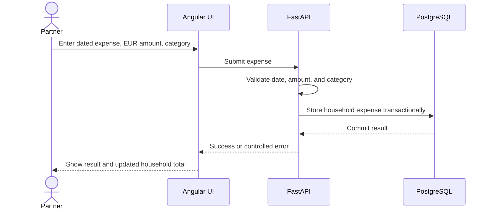

# Personal Expense Tracking

## Status

Requirements are partially confirmed and the initial architecture is selected. GitHub issues #1-#4 are registered. Issue #1 is in progress: Angular and FastAPI local checks and PostgreSQL container integration pass. Remaining product decisions must be resolved before implementing affected later issues.

## Objective

Manage shared household finances for two partners, recording household expenses and the income of each partner.

## Workbook Observations

Source: `Pingvinukas_Coins.xlsx` in the parent workspace directory (outside this repository).

- The workbook has a `General` sheet and separate `Bills`, `Groceries`, `Beauty`, `Transports`, `Eat_out`, and `Clothes` sheets.
- The sheets contain month rows for November and December. The `General` sheet also contains numeric values in columns C and D, but those columns have no visible headers.
- The `General` sheet has visible `Total`, `Profit`, and `Expenses` headings. Formulas add the unlabeled C/D values for `Total`, subtract `Expenses` from `Total` for `Profit`, and aggregate category totals for `Expenses`.
- The user confirmed that column D (blue) is their income and column C (pink) is their girlfriend's income. Household expenses are counted together, not attributed to either partner.
- Expense sheets contain category-specific subcategory headings and monthly totals. For example, `Bills` includes Water, Electricity, Heating, Home Internet, and Phone Plan; `Transports` includes Bus, Spark, and Bolt/Uber.
- The user wants expenses recorded on their actual dates. The application currency is euros (EUR).
- Preserve the workbook's expense categories and subcategories, except omit the Groceries subcategories for now. The Groceries category itself remains.
- Budgets, recurring bills, and income tracking are in scope. Their detailed behavior remains to be agreed.
- The workbook does not visibly record individual transaction dates, merchants, or descriptions. These are workbook observations only; no requirement to include or exclude merchant/description fields has been confirmed.
- The `Groceries` sheet spells one subcategory `Diary`; Grocery subcategories are out of scope for now, so this label does not need to be resolved for the initial version.

## Confirmed Requirements

| ID | Type | Requirement |
| --- | --- | --- |
| FEAT-001 | Functional | Record household expenses by actual date, in EUR. |
| FEAT-002 | Functional | Count expenses together as household expenses; do not attribute an expense to one partner. |
| FEAT-003 | Functional | Track income separately for the user and girlfriend, and support a combined household income view. The spreadsheet mapping is D (blue) = user and C (pink) = girlfriend. |
| FEAT-004 | Functional | Use the expense categories and non-Groceries subcategories found in the workbook. Omit Groceries subcategories for the initial scope. |
| FEAT-005 | Functional | Support monthly budgets per expense category and show a free in-app warning when actual spending reaches 80% of a category limit. Show an exceeded state above 100%. |
| FEAT-006 | Functional | Allow one-off bills and monthly recurring bills to be registered with pending or paid status and a due date. Recurring bills provide a default amount that can be adjusted for each occurrence before payment. Show pending/overdue bills in the app without paid email, SMS, or push services. A bill contributes to actual expenses and budgets only when marked paid, using its paid amount and paid date. |
| FEAT-007 | Functional | Provide monthly household summaries with combined income, combined expenses, and the remaining balance (income minus expenses). |
| TECH-001 | Technology constraint | Use Angular for the frontend. |
| TECH-002 | Technology constraint | Use Python for the backend. |
| TECH-003 | Architecture decision | Use FastAPI for a typed REST API with generated OpenAPI documentation and request validation. |
| TECH-004 | Architecture decision | Use PostgreSQL for persistent relational data, with SQLAlchemy for persistence and Alembic for schema migrations. Use Python `Decimal` and PostgreSQL `NUMERIC` for EUR amounts to avoid binary floating-point rounding. |
| NFR-001 | Maintainability | Follow SOLID, DRY, and KISS; keep code simple, scalable, and testable, avoiding hacks and drift. |
| NFR-002 | Testing | Include tests for each implementation and maintain a consolidated test/error-handling table with actual execution results. |
| NFR-003 | Security and privacy | No elevated security or privacy requirements have been requested. Access/deployment model remains open; this does not remove ordinary input validation or safe error handling. |
| NFR-005 | Cost | The app should be free to use and should not require paid licenses or notification services. Hosting costs depend on the deployment choice, which remains open. |

## Scope and Boundaries

- Confirmed: dated household expenses; separate income tracking for each of the two partners; combined household expense totals; categories and subcategories copied from the workbook except Groceries subcategories; EUR; monthly summaries; monthly budgets per category with an in-app warning at 80%; and one-off or monthly recurring bills with pending/paid state, in-app pending/overdue visibility, and expense accounting only on the paid date.
- Not confirmed: whether expenses and income can be edited/deleted; required transaction metadata beyond date, amount, and category; income dates and sources; and account/access and deployment model.
- Treat spreadsheet sample values and formulas as reference data, not as requirements. In particular, do not carry over spreadsheet formula behavior without confirming the desired calculations.

## Acceptance Criteria

- A user can record an expense with an actual date, EUR amount, and applicable workbook category/subcategory; it contributes to shared household expense totals rather than an individual partner's total.
- A user can record income for either partner and view the two partner-specific amounts separately and together.
- Expense categories match the workbook; Groceries has no subcategory selection in the initial version.
- Monthly summaries show combined income, combined expenses, and income minus expenses.
- Monthly budgets are tracked per expense category; an in-app warning appears at 80% and an exceeded state appears above 100%, with no external paid notification service.
- One-off and monthly recurring bills have due dates and pending/paid status. Recurring bills use a default amount that can be adjusted per occurrence. Pending and overdue bills are visible in-app; marking a bill paid records its paid amount and paid date, and only then does it contribute to actual expense totals and budgets.
- Invalid input and backend/storage failures produce controlled, understandable errors and do not report an unsuccessful write as successful.
- Detailed acceptance criteria for alert thresholds, recurring-bill scheduling, and account access are pending the open decisions below.

## Design and Architecture

Selected initial architecture:

```text
Angular application -> FastAPI REST API -> PostgreSQL
							|
				  SQLAlchemy + Alembic
```

- FastAPI keeps the Python backend focused on a typed HTTP API, validation, and OpenAPI contracts. It is a good fit for a small, testable application without introducing a larger framework's extra conventions.
- PostgreSQL provides relational integrity and transactional writes for expenses, income, budgets, recurring bills, and categories. It is a suitable default for a shared household application where both partners may use it.
- SQLAlchemy is the persistence boundary; Alembic manages schema changes. Keep domain calculations and validation out of route handlers so they can be tested independently.
- Represent money with decimal arithmetic (`Decimal` in Python; `NUMERIC` in PostgreSQL), not floating point. Currency is fixed to EUR for the current scope.
- Keep the backend as one modular application; no microservices are warranted by the current scope.
- Authentication, hosting, and deployment topology are not selected because the access model and operating environment are not yet known.

## Domain Model and Diagrams

Initial domain concepts, pending final behavior:

- **Household:** the shared financial scope.
- **Member:** one of the two partners; income is associated with a member.
- **Expense:** dated EUR amount and category, optionally a subcategory where that category has subcategories. It belongs to the household and is not assigned to a member.
- **Income:** dated EUR amount associated with one member.
- **Category / subcategory:** the expense classification from the workbook, except Groceries subcategories are omitted initially.
- **Budget:** a monthly spending limit for an expense category; show an in-app warning at 80% and an exceeded state above 100%.
- **Bill:** a one-off or monthly recurring payable item with due date and pending or paid status. A recurring occurrence starts with the schedule's default amount, which can be adjusted; only its paid amount contributes to actual expenses, on its paid date.
- **Recurring bill:** a monthly schedule that produces pending bill occurrences; pending and overdue occurrences are shown in-app without external notifications.

The following is a conceptual write flow, not an API contract:



## Open Questions

- Should income entries also have actual dates? Are income sources limited to the two partners, and can either partner have multiple income sources?
- Can users edit/delete financial records? Is a description or payee needed on expenses?
- Are workbook categories fixed, or should users be able to add/edit categories later?
- Does each partner need an individual login, or is a single shared household access method sufficient? Where will the application run?
- What accessibility expectations apply? No elevated security/privacy requirements were requested.
- Must hosting also have zero cost, or does "free" mean no charge to use the app and no paid software/notification services? Hosting costs depend on the eventual deployment choice.

## Registered GitHub Tickets

| Issue | Scope | Status |
| --- | --- | --- |
| [#1 Scaffold Angular, FastAPI, and PostgreSQL foundation](https://github.com/miguellemos95/household_finances/issues/1) | Local app/API/database foundation, health/readiness, migrations, startup documentation, and test setup. | In progress; PostgreSQL integration verified |
| [#2 Implement household expense and income ledger](https://github.com/miguellemos95/household_finances/issues/2) | Shared dated expenses, per-partner monthly income, workbook categories, and monthly summary. Depends on #1. | Registered |
| [#3 Add monthly category budgets and in-app alerts](https://github.com/miguellemos95/household_finances/issues/3) | Monthly category budgets with in-app 80% warning and over-budget state. Depends on #2. | Registered |
| [#4 Add one-off and recurring bill tracking](https://github.com/miguellemos95/household_finances/issues/4) | One-off/monthly bills, due dates, pending/paid lifecycle, adjustable occurrences, and paid-date expense accounting. Depends on #2 and #3. | Registered |

The user's request to register these issues and begin implementation authorizes proceeding with #1. Do not start #2-#4 until their dependencies and remaining product questions are addressed.

## Tests and Failover

The consolidated "failover" table primarily covers application error handling; infrastructure failover is out of scope. The following table records #1 outcomes. Do not report unexecuted checks as passed.

| Test ID | Requirement / acceptance criterion | Level | Scenario / failure condition | Expected outcome / recovery | Actual outcome | Status | Evidence |
| --- | --- | --- | --- | --- | --- | --- | --- |
| FND-001 | #1 local startup and frontend/API communication | Smoke | Start Angular and FastAPI; open the documented localhost URL | Both start and the frontend reports API connected | Passed: `/health/live` returned `200`; Angular displayed “API connected” at `http://localhost:4200/` | Passed | Local FastAPI and Angular dev servers |
| FND-002 | #1 readiness and error handling | API / error path | Check readiness with PostgreSQL unavailable; exercise healthy and failed SQLAlchemy connections in tests | Live endpoint remains available; readiness returns controlled `503`; no database internals leak | Passed: live returned `200`; readiness returned `503`; tests verified SQLite readiness and sanitized SQLAlchemy failure response | Passed | `backend/tests/test_health.py`; local HTTP checks |
| FND-003 | #1 migration setup | Integration | Initialize a clean temporary database with Alembic and generate PostgreSQL migration SQL | Migration completes and the revision is recorded | Passed against temporary SQLite; PostgreSQL-dialect SQL generation passed offline; baseline migration also applied to local PostgreSQL | Passed | `test_clean_database_can_be_initialized_by_migrations`; `alembic upgrade head --sql`; local `alembic upgrade head` and `alembic current` |
| FND-004 | #1 test setup | Automated | Run documented frontend/backend test commands and frontend production build | All tests and build complete successfully | Backend: 4 passed; Angular: 2 passed; production build passed | Passed | `python -m pytest`; `npm test -- --watch=false`; `npm run build` |
| FND-005 | #1 PostgreSQL service integration | Infrastructure / integration | Start PostgreSQL with `docker compose` and run readiness and migrations against it | PostgreSQL starts, readiness succeeds, and migrations complete | Passed on 2026-11-21: container healthy, PostgreSQL migration at `0001_initial`, API readiness returned `200` against PostgreSQL; backend tests 4 passed | Passed | `docker compose up -d --wait db`; `pg_isready`; `alembic upgrade head`; API readiness check; `python -m pytest` |